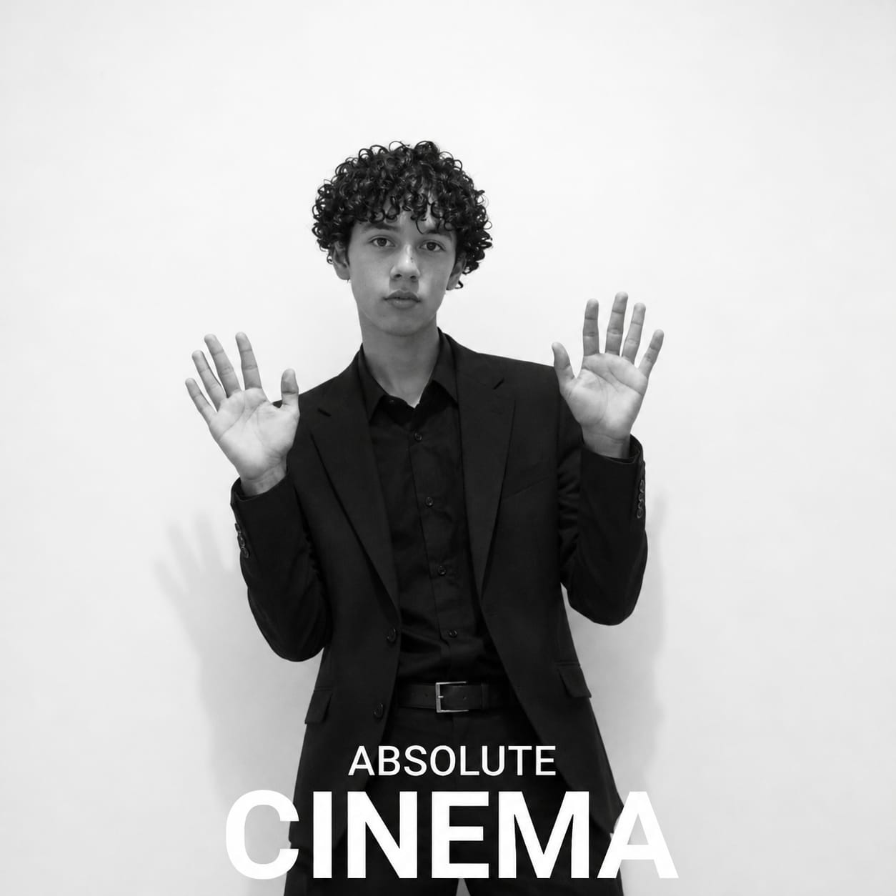

<div style="background: rgba(29, 36, 43, 1); border-radius: 20px;">
 <!-- Banner con efecto Neón / Glitch Spider-Verse -->
  

<div style="display: flex">
  <div align="center" >

  <!-- Imagen con marco estilizado Spider-Verse (Halftone / Glitch / Neon Cyan & Magenta) -->
  <table border="0" style="background: transparent; border: none;">
    <tr>
      <td align="center">
        <a href="https://github.com/estebann123107">
          
        </a>
      </td>
    </tr>
  </table>

  </div>
  <div style="padding-left: 40px; width: 50%; height: auto">

### 🕷️ `About Me`

```bash
const esteban = {
  name: "Esteban Meléndez",
  role: "Frontend Developer",
  degree: "Ingeniería de Sistemas",
  
};
```
  </div>
</div>
<!-- Subtítulo animado estilo máquina de escribir -->
  <a href="https://git.io/typing-svg">
    
  </a>

  <p align="center">
    
  </p>
</div>

### ` Tech Stack`

<div align="center">

  

</div>

---

###  ` GitHub Stats`

<div align="center">
  <table border="0">
    <tr>
      <td>
        
      </td>
      <td>
        
      </td>
    </tr>
  </table>

  <br/>

  <!-- Racha de contribuciones animada -->
  

</div>

---

### 📡 `Interdimensional Comms // Contact`

<div align="center">

  <a href="mailto:tuemail@ejemplo.com">
    
  </a>
  <a href="https://linkedin.com/in/tu-perfil">
    
  </a>
  <a href="https://github.com/estebann123107">
    
  </a>

</div>

<br/>

<div align="center">
  
</div>
